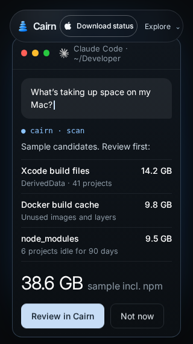
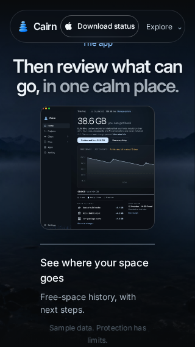
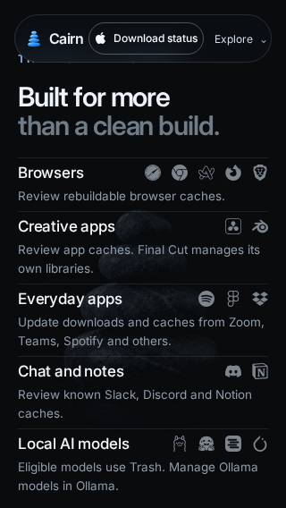
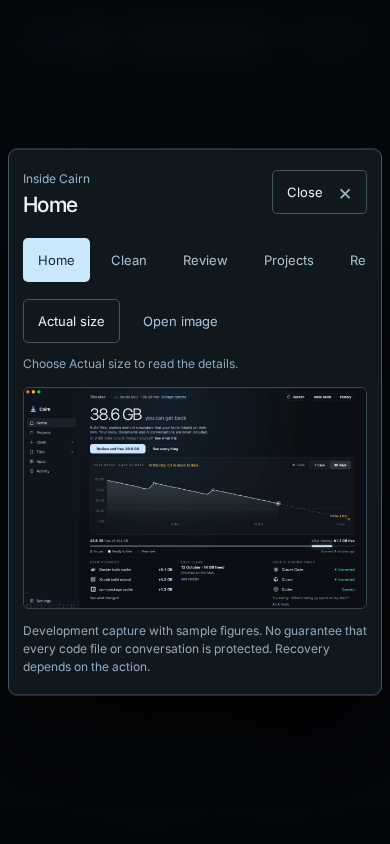
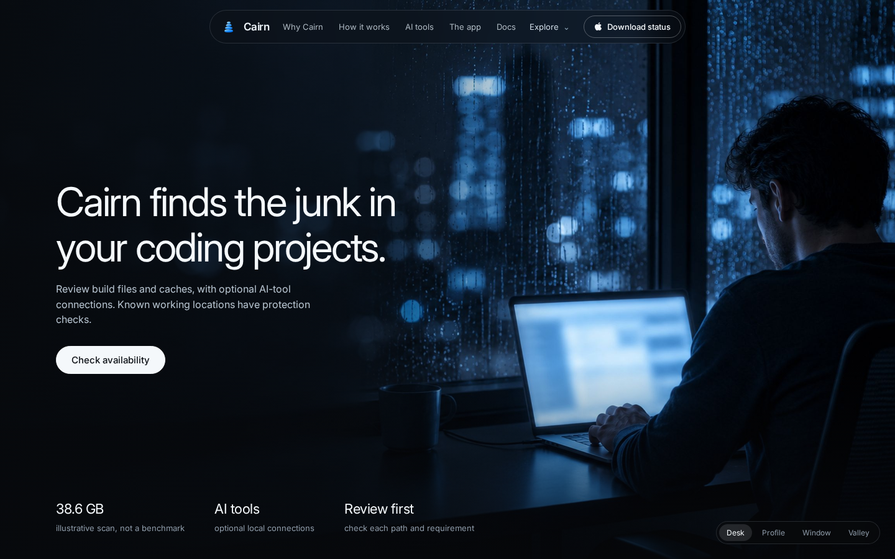
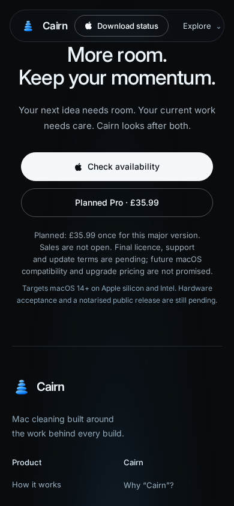

# Website claim correction verification

Content and browser checks passed on commit `359cf11e40d0c599d7fe4a258daf498f5744a104` (tree `22bb1b87d03b39e77652fc027fd550d69a6b2630`). The following evidence-only commit adds this report and selected unmodified screenshots; it does not change website content.

[Successful website workflow](https://github.com/EmotiveImpact/Cairn/actions/runs/42734459256) · [Exact wording and source evidence](CLAIM-REVIEW.md) · [Machine-readable layout report](browser/layout-report.json)

## Results

| Check | Result |
| --- | --- |
| Build and interactions | Pass: production bundles; product tour, gallery, zoom, tabs, Escape/focus return, navigation and menu lifecycle |
| Site and docs | Pass: 18 active pages, six docs pages, 568 local references |
| Claim regression | Pass: visible text, metadata, accessible gallery descriptions, scene-specific sample labels, accounting, consent, recovery, planned terms and unavailable transactions |
| Negative fixtures | Pass: misleading visible copy, metadata, hidden gallery text and purchase CTA are rejected |
| Preservation | Pass: original whole-homepage SHA after reversing only 69 enumerated homepage copy edits; original main-markup hash and four cinematic script/style hashes retained |
| Production gallery bundle | Exactly one literal text replacement; no interaction behaviour change |
| Export | Pass: portable static export has the same content and preservation checks |
| Browser | Pass: 18 pages at five viewport sizes; animated stages, fully revealed chat, gallery caveat and reduced-motion presentation; no JavaScript errors or measured revised-copy overflow |

## Rendered coverage

| Chromium viewport | Animated stops | Supporting pages |
| --- | ---: | ---: |
| 320 × 568 | 10 | 17 |
| 390 × 844 | 10 | 17 |
| 768 × 1024 | 9 | 17 |
| 1024 × 768 | 9 | 17 |
| 1440 × 900 | 9 | 17 |

The first browser run identified two vertical text overflows at 320 × 568. Shortening app and category descriptions resolved them without CSS, geometry or animation changes. The chat labels were also shortened after visual inspection, and its controls were added to the overflow check. The final test waits until the chat has finished revealing its result and opens the expanded screenshot gallery at every viewport size, waiting for its opening animation to finish.

Chromium viewport emulation is not physical iPhone/Safari testing, native Mac acceptance, live licensing verification or notarisation. Existing captures contain historic sample figures and safety wording, so the adjacent caption and expanded gallery text explicitly qualify them.

At 320 × 568, the retained fixed header overlaps small scene kickers and the AI-tool tabs. The revised claim text, sample labels and chat action buttons fit the viewport. This PR preserves the existing navigation treatment; it does not claim that every element is free of occlusion at this smallest size.

## Selected rendered evidence

### 320-story-5.png

SHA-256: `c99d0b7678b49afdd05f6f8105263be49ea93be5a479ed2bf794b202d051b752`

### 320-story-6.png

SHA-256: `ae4a1b770584657e5441c478066cdf40cc2db696a9e8ba925e657e8ce44f47c1`

### 320-story-9.png

SHA-256: `1e1730656dc32f7a5d43a17c15bbf5d864fe5901a634a16443d3e8e606e92451`

### 390-gallery.png

SHA-256: `973a51b829d56302b8872fb01372f244e761e61843de7986fa545f199581778d`

### 1440-story-0.png

SHA-256: `c4476f967c4c133739db379d598fa6494d4906ff4d0ce832605715e1d2b9637d`

### 390-footer.png

SHA-256: `dd71b9e1141db51d75790544ab9e66dbb0640907fc611e919c936a4e8f0a42ab`

## Release and approval boundaries

- Source and test review is pinned to master `7129dff82375694c4248ee6cd187c183314357c3`, including PRs #27 and #28.
- [PR #27 native CI](https://github.com/EmotiveImpact/Cairn/actions/runs/42720760461) passed at `8193b1cbb4ce367a94e871bed04ee95fef1ca75e`; this remains the supporting evidence for implemented consent, cancellation, model recovery and gem safeguards.
- The existing native CI also runs automatically on this PR. Its latest status is visible in PR checks; no native source, packaging or native CI definition changed here.
- No public download, checkout or live customer release has been verified or enabled.
- PR #29 remains a draft. No merge, deployment or publication was performed; each requires explicit owner approval.
