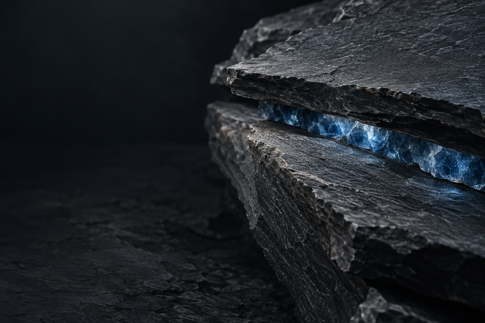

## Documentation — 30 September

The active `night.html` links to a new [local documentation area](docs-preview/index.html) from its header and footer. The source is a six-page [Mintlify project](docs/README.md) with `docs.json` navigation and MDX pages. `npm run build:docs` regenerates the offline HTML preview from those same pages; `npm run test:docs` checks page routes, local links, assets, and website entry points. The docs describe an in-development macOS product and do not offer a public download. Mintlify hosting is not configured.

## Current revision — 29 September

Open `night.html` (also available as `night-refined.html`). The hero now uses the mineral seam with the flat screenshot aligned to the copy. The stones have a dedicated protection panel. Product chapters are separate scroll-visible sections again, retaining refined width and typography. `night-before-image-swap.html` preserves the tabbed revision; `night-before-refinement.html` preserves the earlier comparison.

# Cairn website, version two

This is a second local homepage direction for comparison with [version one](../index.html). It uses the exact approved Cairn app icon and real, labelled sample app captures. Generated artwork is supporting material, never a replacement logo.

The daylight page and earlier studies use [Instrument Sans](https://fonts.google.com/specimen/Instrument+Sans). The active night page uses Google Fonts Inter Variable, matching the font family inspected on [Linear’s contact page](https://linear.app/contact). The daylight page and preserved night study share transparent navigation and a layout for direct image comparison. The current night page explores a different editorial structure with a translucent sticky menu.

## Current refinement

Open [the refined night page](night-refined.html) for the latest version, or [the saved previous page](night-before-refinement.html) to compare. The fresh entry points to the same active `night.html` source.

This pass uses a consistent type scale, one flat hero screenshot constrained to its column, a shorter two-line problem statement, one four-step product walkthrough, concise protection and feature sections, and the existing dark footer. Every preview CTA now opens the same five-screen viewer. Its Actual size control displays the original capture in a scrollable region, including on narrow screens. The previous version retains its own CSS and JavaScript.

The saved older design notes below describe earlier iterations. [Refinement notes](refinement-notes.md) describe the active layout. The product remains in development; no signup, download, or public release is implied.

## Pages

- [Daylight homepage](index.html) — the recommended version two direction.
- [Night homepage](night.html) — a developer-focused story informed by the pacing of [Save.design](https://save.design/?ref=saaspo.com), the concrete scenario flow on [Giga](https://giga.ai/), [Deck](https://deck.co/?ref=saaspo.com)'s compact menu, wide product stages, and footer, and [Payload](https://payloadcms.com/?ref=saaspo.com)'s immediate product proof and developer hierarchy. It follows one sample case from low storage through measured change, a space target, exact-path review, protection, and outcome.
- [Night before the screen hero](night-before-screen-hero.html) — saved immediately before the latest hero and footer redesign, with its own preserved stylesheet.
- [Previous night homepage](night-previous.html) — the earlier matching-layout night study, preserved for comparison.
- [Version one homepage](../index.html) — the earlier direct, all-dark product-led concept.

## Generated image studies

**Daylight hero:** cool architectural light makes the dark app icon and native screenshot stand apart. The same stone image now opens the night page, behind a split hero with a single flat native Overview screen. The footer returns to dark, with a blue glow rising from the bottom and no oversized wordmark.

**Previous night hero:** a moodier physical interpretation of the same four-stone idea, retained on the previous night page.

**Earlier night stage:** a dark basalt landscape with blue seams, retained in the saved pre-redesign night page. The existing approved icon and native app captures remain the only product identity and interface imagery.

The night page also uses labelled native sample captures of Overview, Changes, Make room, Developer Cleanup, and Activity & Recovery from the current storage-control checkpoint. Its audience, narrative, source boundaries, and reference decisions are recorded in [night-story.md](night-story.md).

**Supporting image:** a precise blue seam through graphite stone for the section about protecting work.

ImageGen produced each raster asset separately. Final copies are stored here so the pages do not depend on generated-image cache paths. No site was published. The local browser URL policy blocked this task from rendering the HTML, so responsive visual QA remains open.

Static validation of `night.html` on 29 September found no duplicate IDs, broken local references or anchors, or images without alt text. Its CSS, including the responsive rules, parsed without errors. The native captures and generated art have the declared image dimensions. These checks do not establish rendered layout quality.

## Latest opening: 29 September

The active `night.html` now has a genuinely different first screen: the lighter four-stone artwork at the top, developer headline on the left, and one large, flat Overview capture on the right. The top, lower product screenshots, and final CTA open an accessible native dialog with five selectable app captures. Links fall back to the image files if JavaScript or dialog support is unavailable. The header retains the approved icon, small scale, and translucent background.

The closing CTA and footer are one dark composition, lit from the bottom. The large CAIRN wordmark remains removed. `night-before-screen-hero.html` and its stylesheet preserve the exact previous composition. The active stylesheet and preview script have a version query to avoid stale cached assets after refreshing the page.

The night page’s full-height name explanation has been removed from the product story. Its meaning is now a short, collapsed “Why Cairn?” note in the footer. Features lead directly into the final CTA.

The current night hero keeps “Built for developers.” on one line. Inter at weight 510 and -0.022em tracking follows the reference; the headline scales with its own column. Font metrics were checked against the actual Google Fonts response at viewport widths from 320 to 1920 pixels. This is a fit calculation, not a browser layout test.

### Refinement checks

- Unique IDs, local references, internal anchors, preview targets, panel labels and controls, and image dimensions passed.
- CSS and JavaScript syntax passed; the hero headline fit was checked using previously measured Inter metrics across 320–1920px viewports.
- jsdom checks passed for initial and direct-link selection, four workflow steps, keyboard focus and arrow/Home/End navigation, hash navigation, five preview images, original-image links, zoom/reset, scroll-region focus, closing/unlocking, and the no-JavaScript fallback. Native browser operations were stubbed; these are interaction-logic checks, not browser rendering tests.
- Browser visual QA remains open because of the earlier local-URL policy block. No alternate rendering route was used.
